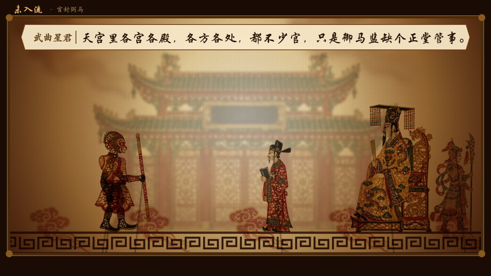
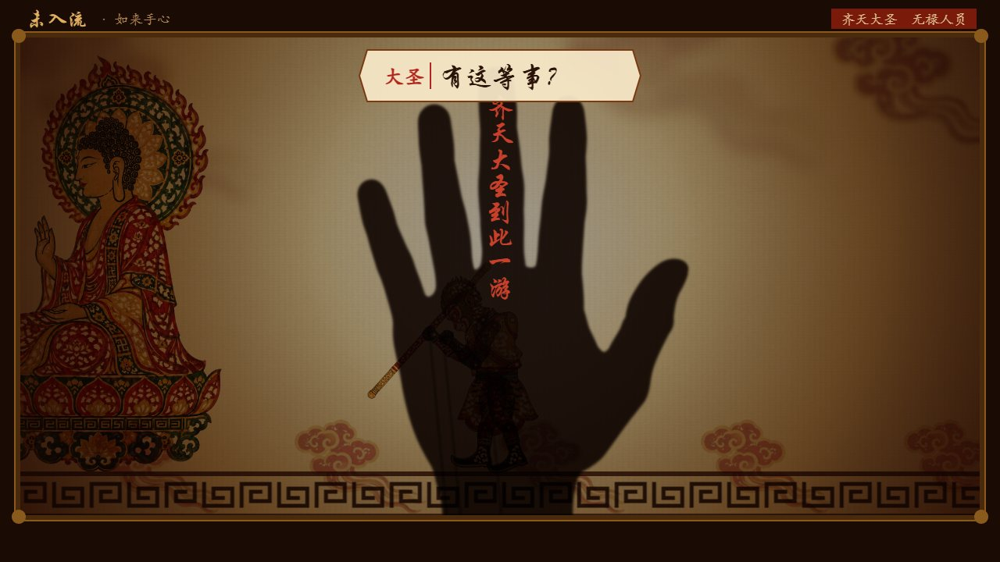
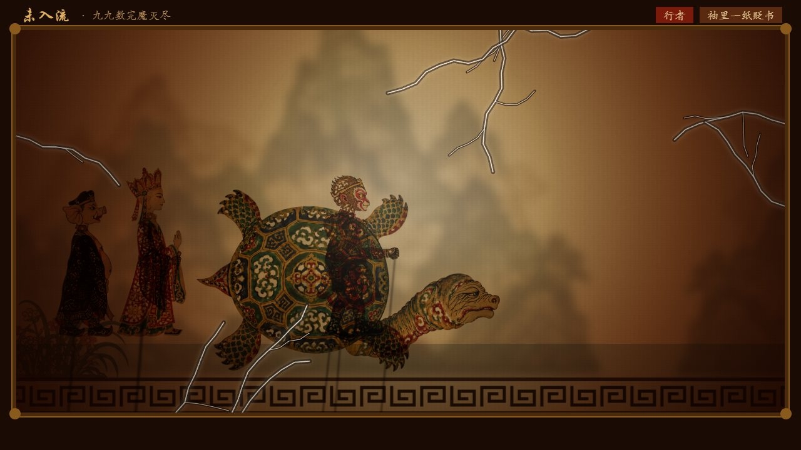
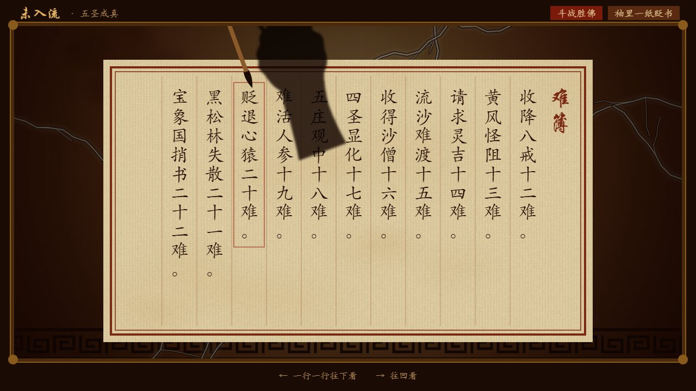

# 未入流

**皮影戏 · 西游记**

> 猿猴道体配人心，心即猿猴意思深。  
> 大圣齐天非假论，官封弼马岂知音。  
>
> ——第七回

一盏灯，一方幕，一部西游。  
戏文皆出原书，一字不易；所易者，次第而已。  
旧事新读，古调今声。

*A shadow-puppet Journey to the West. Every line comes from the original novel; only the order is new.*  
*影絵芝居で演じる『西遊記』。台詞はすべて原作のまま、新しいのは場の並べ方だけ。*

| | |
|---|---|
|  |  |
|  |  |

## 五折

**第一折　入流**  
官封弼马心何足，名注齐天意未宁。　——第四回  
宴设蟠桃猴搅乱，安天大会胜蟠桃。　——第七回

**第二折　自己戴上**  
心猿归正，六贼无踪。　——第十四回

**第三折　白虎岭**  
扫地恐伤蝼蚁命，爱惜飞蛾纱罩灯。　——第二十七回

**第四折　都领回去了**  
外道施威欺正性，心猿获宝伏邪魔。　——第三十五回  
悟空大闹金兜洞，如来暗示主人公。　——第五十二回  
群魔欺本性，一体拜真如。　——第七十七回

**第五折　品级**  
猿熟马驯方脱壳，功成行满见真如。　——第九十八回  
九九数完魔灭尽，三三行满道归根。　——第九十九回  
径回东土，五圣成真。　——第一百回

## 看戏

在线看戏：https://nicolehuo123-lgtm.github.io/weiruliu/  
亦可下载后以浏览器开 `game/index.html`，击回车开锣，无须安装。  
A、D 行走，W 腾跃，J 抡棒；余键随场提示于幕下。  
地址后缀 `?auto=1`，则自行演完全本。  
浏览器语言为日语者，幕下自添日文小字，回目旁注训读；`?lang=ja` / `?lang=zh` 可自择。

*ブラウザが日本語なら、台詞の下に日本語の小さな字幕、回目の横に書き下しが添えられます（`?lang=ja` / `?lang=zh` で切り替え）。*

## 影人

影人照陕西、唐山皮影之制：牛皮镂刻，大红、翠绿、明黄，透灯而见。

## 版权

© 2026 Nicole Huo. All rights reserved.  
版权所有，未经许可，不得复制、改作或他用。  
字体另依 SIL Open Font License 1.1，见 `game/assets/fonts`。
